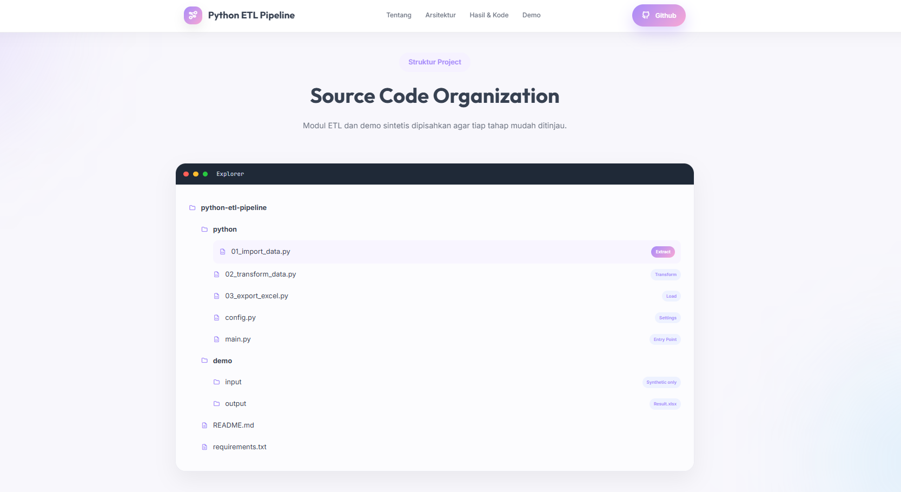

# Python ETL Pipeline

A modular Python ETL project that consolidates CSV files, Excel workbooks, and ZIP archives containing CSV files into a review-ready Excel workbook.

**All files in the demo are synthetic.** This repository does not include company logs, hostnames, IP addresses, application names, or infrastructure details.

## Live Demo

Visit the portfolio website:

👉 [Python ETL Pipeline](https://good-pastel.github.io/python-ETL/)

## Screenshots

### Home

### Architecture

### Code Walkthrough and Results

### Demo

### Project Structure

## Features

- Import .csv, .xlsx, .xls, and .zip files from a configured input folder.
- Read every worksheet in Excel workbooks and CSV members inside ZIP archives.
- Add source metadata: _SourceFile, _SourceType, and _SheetName.
- Consolidate tables with pandas, preserving the union of their columns.
- Parse configured datetime formats and remove rows with invalid dates.
- Filter an inclusive start/end date range, sort chronologically, and derive a numeric Month column.
- Export a summary sheet and one or more monthly data sheets.
- Split large exports to stay within Excel's row limit.
- Freeze headers, enable filters, adjust column widths, and escape formula-like text values.

## Project Architecture

~~~text
CSV / Excel worksheets / ZIP (CSV members)
                 |
                 v
          01_import_data.py
                 |
                 v
   pandas consolidation + source metadata
                 |
                 v
        02_transform_data.py
   parse dates -> remove invalid -> filter
       -> sort -> derive Month
                 |
                 v
         03_export_excel.py
                 |
                 v
 Summary + monthly sheets in Result.xlsx
~~~

## Run the Synthetic Demo

Python 3.10 or later is recommended.

~~~bash
python -m pip install -r requirements.txt
python python/main.py
~~~

The pipeline reads only the example files in demo/input/ and writes the result to demo/output/Result.xlsx.

The included sample files are:

- demo_activity.csv
- demo_activity.xlsx (two worksheets)
- demo_bundle.zip (contains a CSV file)

You can also browse the [synthetic input files](demo/input/) and download the [example output workbook](demo/output/Result.xlsx).

## Synthetic Demo Results

The example contains 9 rows across 3 input files. The configured date window is March 1–31, 2025, inclusive.

| Data quality check | Result |
| --- | ---: |
| Rows imported | 9 |
| Dates parsed successfully | 8 |
| Invalid dates removed | 1 |
| Valid dates outside the window | 1 |
| Rows exported | 7 |
| Workbook sheets | Summary, 03 |

These numbers describe only the synthetic demo dataset. The pipeline does not automatically remove duplicate rows.

## Code Walkthrough

### 1. Extract and consolidate

The importer reads CSV files, all sheets in Excel workbooks, and CSV members in ZIP archives. It adds source metadata and combines the resulting DataFrames:

~~~python
df = pd.concat(
    dataframes,
    ignore_index=True,
    sort=False,
)
~~~

### 2. Transform and check dates

The transform module tries the date formats listed in python/config.py. Values that do not match become NaT; invalid rows are removed before the date filter.

The pipeline then applies the configured inclusive date range, sorts by Timestamp, and adds Month as a number from 1 to 12.

### 3. Export the workbook

The exporter creates a summary and writes data into monthly sheets such as 03. It can split large sheets into numbered parts and formats each output sheet for review.

## Configuration

Edit python/config.py to change:

- INPUT_FOLDER and OUTPUT_FILE
- DATE_COLUMN and supported DATE_FORMATS
- START_DATE and END_DATE
- Monthly sheet splitting and Excel formatting options

The example configuration points to the synthetic demo folder. Review permissions and remove sensitive fields before using any real data.

## Project Structure

~~~text
python-ETL/
├── assets/                
├── demo/
│   ├── input/              # Synthetic CSV, Excel, and ZIP examples
│   └── output/Result.xlsx  # Synthetic example workbook
├── python/
│   ├── 01_import_data.py
│   ├── 02_transform_data.py
│   ├── 03_export_excel.py
│   ├── config.py
│   └── main.py
├── index.html              # Portfolio page
├── requirements.txt
└── README.md
~~~

## Technologies

- Python
- pandas
- openpyxl
- CSV, Excel, and ZIP file handling

## Limitations

- ZIP archives are read for CSV members only. Nested archives and Excel files inside ZIPs are not processed.
- Columns are combined by name; automatic semantic column mapping is not included.
- The configured date column and formats must match the input files.
- Invalid dates are discarded; duplicate rows are retained.
- The demo output file is overwritten each time the pipeline runs.

## Author

**Devi Yolanda**

Technical Writer • Python Learner • Aspiring Data Analyst
